# Howler Manual

*[Versión en español](MANUAL.md)*

Howler stores the lap times of your Assetto Corsa server and shows them on a website: standings, records, driver profiles, a lap comparer and championships. It also controls the server from a panel. It replaces stracker.

**How to read this manual.** You don't need to read all of it:

| I want to… | Go to |
|---|---|
| Install Howler and see my first lap time | [1. Start here](#1-start-here) |
| Do one specific task (championship, Discord, backups…) | [2. How to…](#2-how-to) |
| Fix something that doesn't work | [3. If something goes wrong](#3-if-something-goes-wrong) |
| Look up a setting, a port or a folder | [4. Reference](#4-reference) |
| Understand why it works this way | [5. Why it works this way](#5-why-it-works-this-way) |

Conventions: **Button** = something you click · `code` = something you type, or a file · **Important**, **Tip** and **Careful** (the last one only when something can break or data can be lost).

> The screenshots show the Spanish interface. Howler's panel and website can be switched to English in **Settings → General**; button names below are the English ones.

---

# 1. Start here

## What Howler is (and isn't)

Howler is **not** a game server: it uses yours. It is installed on the same PC as the Assetto Corsa server, listens to what happens in it (laps, collisions, sessions) and saves it in its own database. From that it builds the website and the panel.

It has three parts:

- **The website** (port 8420): anyone you show it to can open it. Read-only.
- **The panel** (port 8421): opens only from the server PC itself. You start the server, change rules and build championships here.
- **The plugin** (`HowlerPlugin`): a small piece installed inside the server that gives Howler exact sector times. Without it Howler still works, but sectors are an estimate.

## What you need

| You need | Detail |
|---|---|
| Windows 10 or 11 | The same PC that runs the Assetto Corsa server |
| An Assetto Corsa server | Made with Content Manager. The installer can upgrade it to AssettoServer for you |
| 5 minutes | The installer makes a backup before touching anything |
| Optional: CSP on the players' side | Only for advanced weather (Pure/Sol) and extra telemetry |

## Install

1. Download `Howler-Setup.exe` from the downloads page.
2. Open it. If Windows shows **“Windows protected your PC”**, click **More info → Run anyway**. It appears because the installer isn't signed with a paid certificate, not because it is dangerous; you can [check that it is authentic](#check-that-the-installer-is-authentic).
3. An installation window opens. Pick the language and accept the license.
4. Choose how to install:
   - **Use my current server** (recommended if Howler finds one). Howler finds it, backs it up to `howler-backup\` and prepares it.
   - **Make a copy in another folder.** Copies your server somewhere else and leaves the original untouched.
   - **Create a new server for me.** Only shown if you have Assetto Corsa and no server. Howler builds a ready-to-use one (AssettoServer, a stock track and car) and connects it to Howler. You change it later from the panel.
   - **Only install Howler.** Doesn't touch any server; you add yours later from the panel or with the [manual installation](#manual-installation). If Howler finds no server, this is the option it suggests.
5. Choose the **installation type**:
   - **Complete** (recommended): opens the website port (8420) in the firewall so your drivers can see it. Asks for administrator permission.
   - **No open ports:** doesn't touch the firewall or open any port; the website only works on this PC. You can open the port later with [this guide](#how-to-show-the-website-to-your-drivers).
   - **Custom:** you choose each option (firewall, shortcuts, start with Windows). Below you see **exactly what is going to happen**.
6. Click **Install**. Howler opens when it finishes.

AssettoServer (version 0.0.55-pre35) ships **inside the installer**: nothing to download.

> **Important.** It installs for your user only (`%LOCALAPPDATA%\Programs\Howler`), without administrator rights. Only opening the firewall asks for permission, and it is optional.

> **Careful.** The installer refuses to continue if `Howler.exe` or the server is running. Close them first.

## See your first lap time

1. In the panel, open **Server → Status and console** and click **Start**.
2. Wait until the indicator at the top right turns green.
3. Join the server with Assetto Corsa and drive one full lap.
4. Open the website: `http://localhost:8420`.

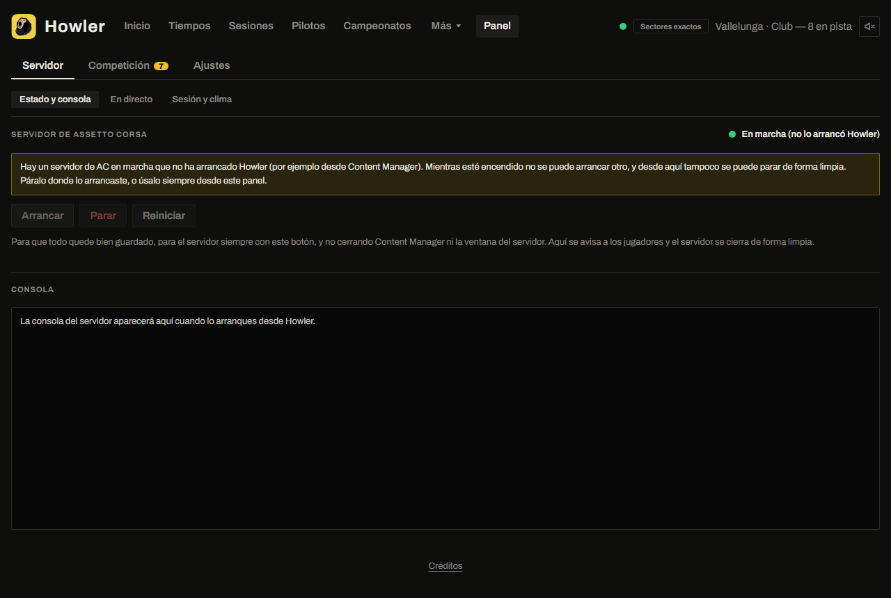

*You should see:* your name on **Home**, with your lap time.

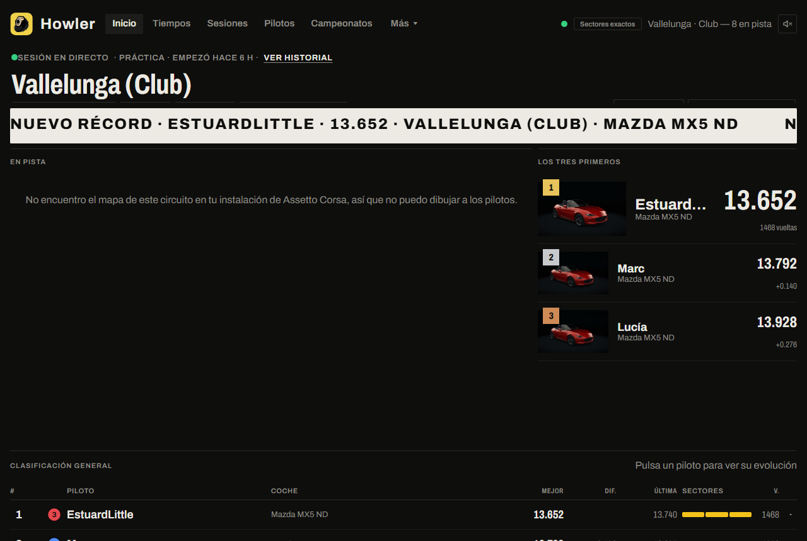

> **Tip.** The first lap after joining has no sectors (Howler didn't see the start). Later laps do.

If you started the server from Content Manager, the panel says **“Running (not started by Howler)”**: it works the same, but the panel can't stop it cleanly. To get that, always start it from Howler.

---

# 2. How to…

Each guide says what it is for, how long it takes and what you need. If a step doesn't give the “You should see…” result, go to [If something goes wrong](#3-if-something-goes-wrong).

## How to show the website to your drivers

*So anyone can see the times from home. 15 minutes.*

**You need:** access to your router's settings.

1. Find your PC's local IP: press **Windows + R**, type `cmd`, Enter, then `ipconfig`. Look at **IPv4 Address** (it starts with `192.168.`).
2. In your router, forward **TCP port 8420** to that IP.
3. Open port **8420** in the Windows firewall (the **Complete** installation type does it; with **No open ports** you have to do it yourself).
4. Find your public IP: from your PC, search “what is my IP” online. Howler doesn't show any address, so you don't share it by accident.
5. From a phone **not on your wifi**, open `http://YOUR-PUBLIC-IP:8420`. The `192.168…` address is only visible to people in your own home or wifi.

*You should see:* the Howler website.

> **Careful.** The **panel** (port 8421) only works on your PC. Don't open it to the outside.

> **Tip.** If your provider doesn't give you your own public IP (CGNAT), use a tunnel (for example Cloudflare Tunnel) instead of opening ports.

## How to start, stop and restart the server

1. Open **Server → Status and console**.
2. Click **Start**, **Stop** or **Restart**.

When stopping, Howler warns the players in chat (10 s by default; change it with `server.stopWarningSeconds`) and closes the server cleanly. When you close Howler, it stops the server it started.

To have the server start together with Howler, set `server.startWithHowler` to `true`.

## How to change cars, skins and track

1. Open **Server → Session and weather**.
2. Under **Server cars**, click **+ Add cars** and pick a car and a skin. The pickers show previews and can be filtered.
3. Watch the `cars/pit boxes` counter: you can't have more cars than pit boxes on the track (spectators don't count).
4. To change the track, click **Change track** in the Track block.
5. Click **Save** and restart the server.

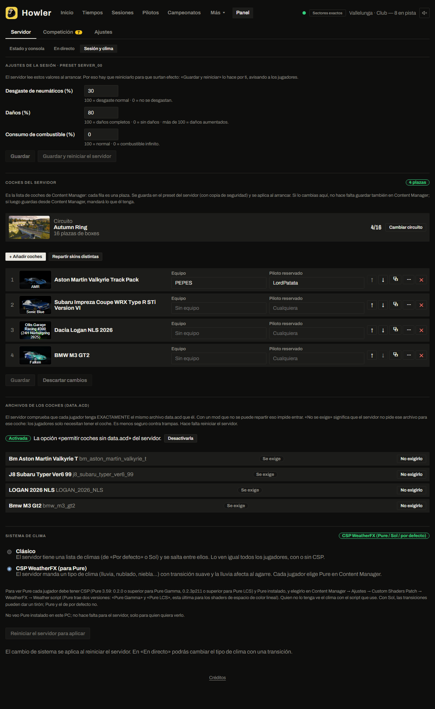

If you have championships you can also give each slot a team and a reserved driver.

> **Important.** Howler keeps a copy of every file it touches (`.howler-prev`). If you later save from Content Manager, Content Manager wins.

## How to change time, weather and session live

1. Open **Server → Live**.
2. Move the time slider (or type the time) and choose a weather.
3. With the server running, the change is immediate.

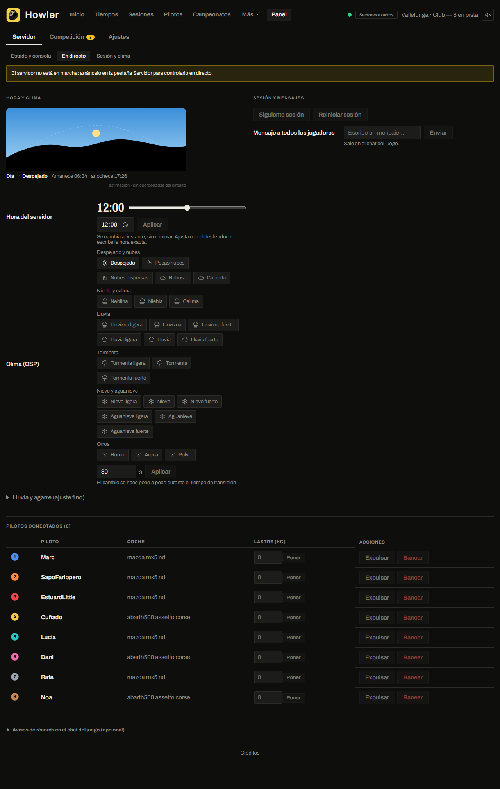

Also here: next session, restart session, chat message, kick, ban, ballast and restrictor.

There are two weather systems, chosen in **Server → Session and weather → Weather system**:

- **Classic**: the preset's weather list (`[WEATHER_n]`). Works with any client.
- **CSP WeatherFX**: for Pure or Sol. Each player picks their script in their own Content Manager, and the server only sends the weather *type*. Needs CSP on the clients.

> **Careful.** Howler does not include or distribute any Pure files (its license forbids it): it only detects them and configures the server.

## How to decide which laps count

1. Open **Competition → Lap rules**.
2. Pick a profile: **Cuts only** (default: leaving the track voids the lap), **Standard** (also hard collisions) or **Strict (like stracker)** (any collision), or create your own. You can give each track a different profile.
3. Click **Test with the history**: you see how many laps would change, without touching anything.
4. Click **Save** (new laps only) or **Save and recalculate the history**.

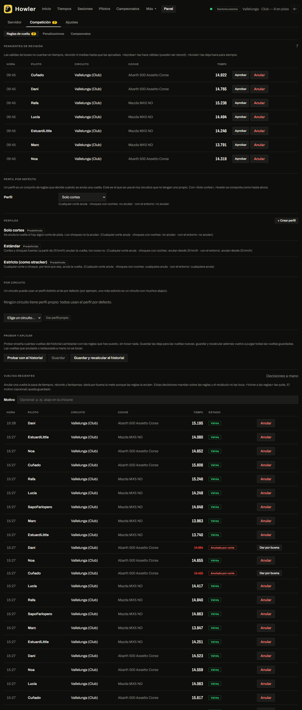

A lap can be **valid**, **void** or **pending review**. Pending ones are pit-exit laps: they don't count until you approve them in the **Pending review** card. You can also void or accept any recent lap, with a reason.

With **Warn the driver**, Howler writes “Howler: lap X voided” in chat with the reason.

## How to penalize a driver in a race

1. Open **Competition → Penalties**.
2. Pick the session and the driver.
3. Pick **Warning** (only recorded), **Added time** (seconds) or **Disqualify**, and write the reason.
4. Tick **Warn in the server chat** if you want the server to see it.

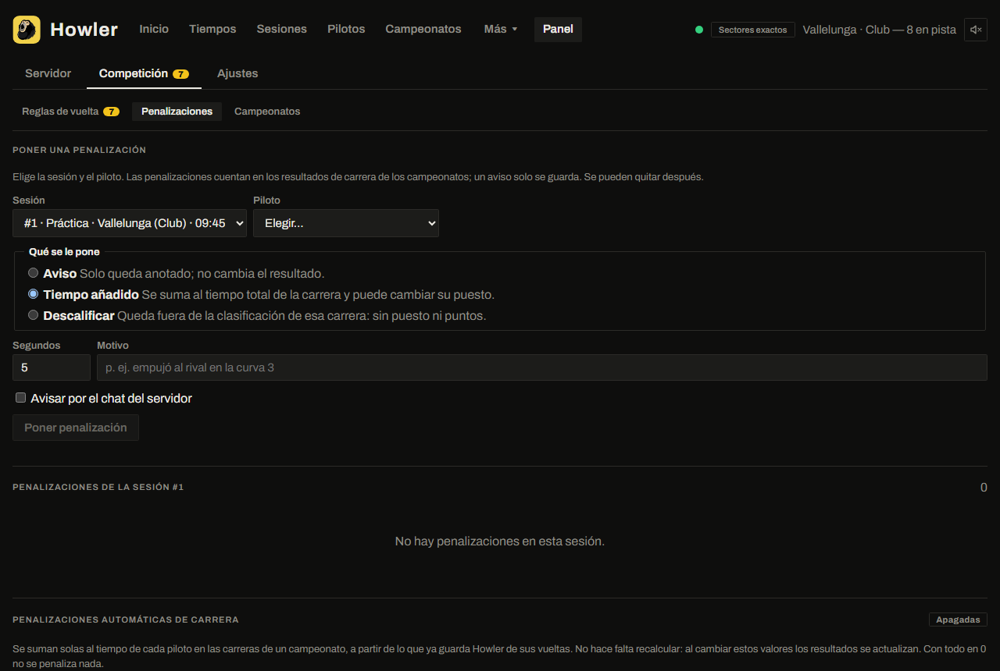

There are also **automatic** penalties (seconds per cut and per collision), off by default. They count only in championship race results; they don't change the times table.

## How to build a championship

*30 minutes the first time.*

1. Open **Competition → Championships → + New championship**.
2. **Type:** name, format (individual, pairs, teams) and image (uploaded from your PC).
3. **Participants:** pick drivers from the server. For someone who has never joined, paste the link to their Steam profile; they are linked when they connect.
4. **Races:** track, allowed cars, schedule (practice, qualifying, race…), weather and mods with their download link.
5. **Scoring:** pick a template (F1, winner only, most laps…) and adjust it.
6. **Summary:** review, set the state to **Active** (visible on the website) and save. With **Draft** it isn't visible outside the panel.

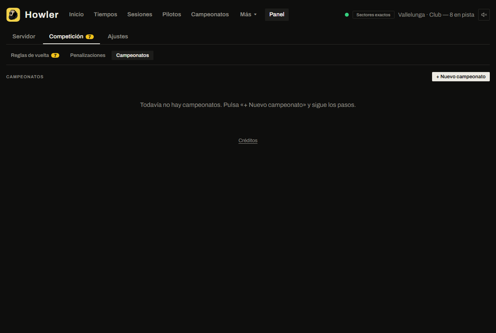

Races are assigned automatically when a session matches the next pending race. If there is doubt, it waits in **Sessions to confirm**. A championship created *after* the sessions doesn't assign them on its own: confirm them by hand.

The public website shows them under **Championships**.

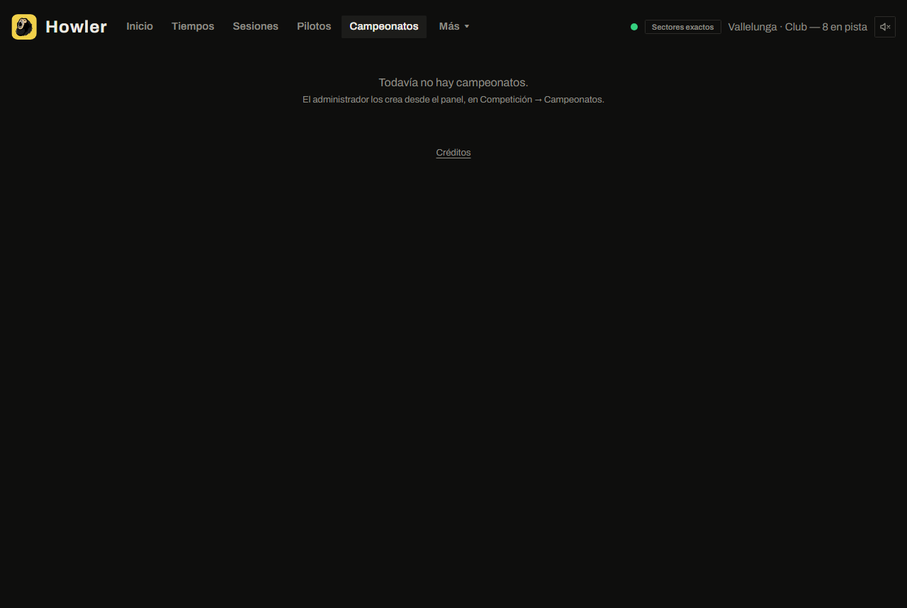

> **Tip.** Race results are rebuilt from the saved laps (the server keeps no official results): whoever completes the most laps wins and, if tied, the lowest total time plus penalties.

## How to import stracker's history

1. Open **Settings → Data → Import**.
2. Upload your stracker `.db3` file (it is always opened read-only).
3. Review the players (link them to Howler's if they already exist) and the tracks.
4. Click **Import**. You can repeat it: it doesn't duplicate.

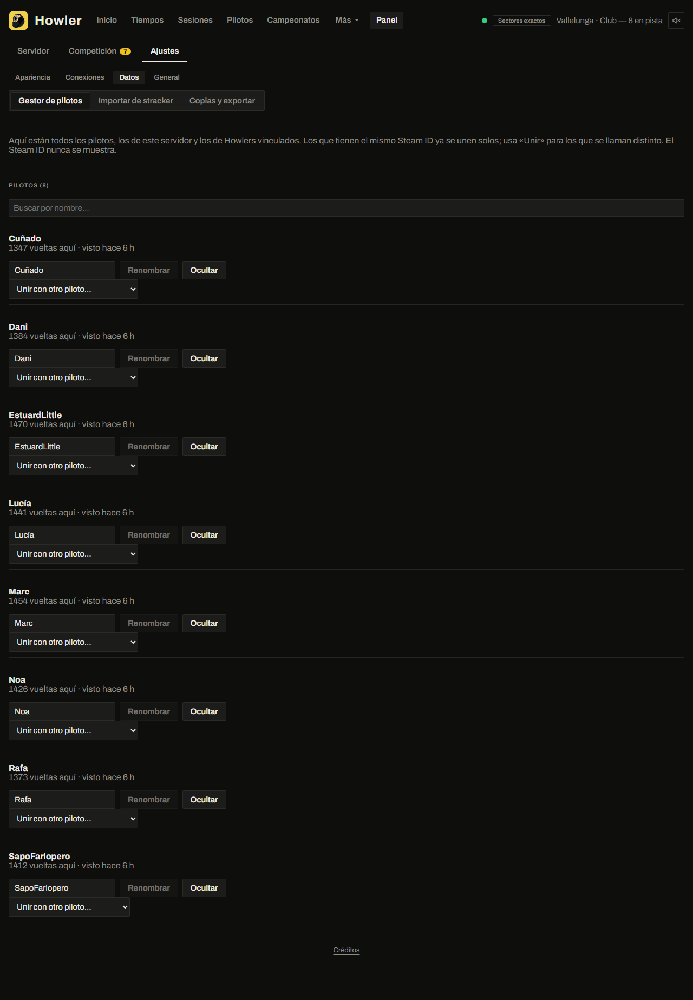

stracker stores neither sectors nor the real Steam ID, so imported drivers may need merging by hand with the real one (**Settings → Data → Drivers**). Howler decides each lap's validity with your rules, not stracker's.

## How to get Discord notifications

1. In Discord: **Channel settings → Integrations → Webhooks → New webhook → Copy URL**.
2. In Howler: **Settings → Connections → Discord**, paste the URL and click **Test**.
3. Turn on the announcements you want (records, server on, new championship…) and change their text if you like.

Each announcement has a **Test this announcement** button. You can add up to 10 channels.

## How to announce records in the server chat

1. Open **Server → Live** and scroll to **Announce records in the server chat**.
2. Tick which records to announce: session best, track-and-car, or absolute track record.
3. Change the text if you like (`{piloto}`, `{tiempo}`, `{coche}`, `{circuito}`, `{anterior}`, `{mejora}`; the English names work too in the editor).

## How to link two Howlers (MultiHowler)

*To share times between two servers without a common database. 10 minutes.*

1. On Howler A: **Settings → Connections → MultiHowler**. Fill in **Your website address** and click **Copy invitation**.
2. Send the invitation to the other person.
3. On Howler B, paste the invitation into **Link with another Howler** and choose whether you want to receive, give or both.
4. On A a request appears: **Approve** it with the permissions you want.

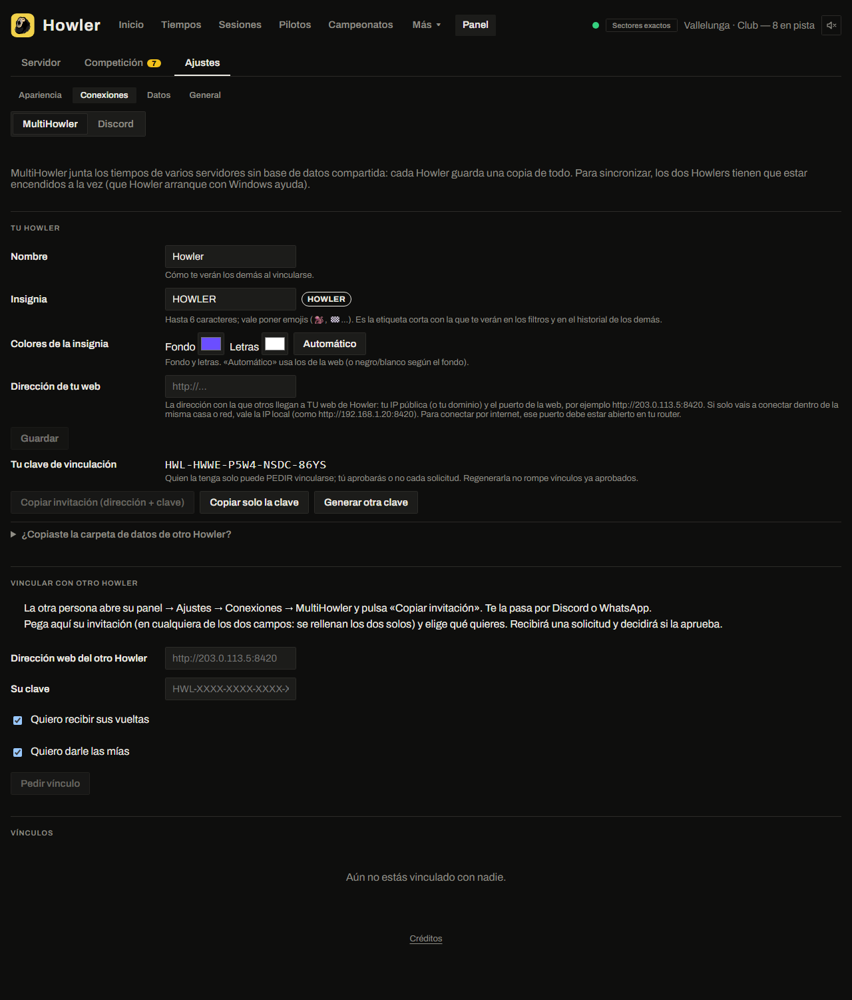

Data only flows from A to B if A gives **and** B receives. Each link shows when it last synced. You can **hide** a link's data (reversible) or **delete** it.

> **Important.** It is enough for one of the two to be reachable from the internet, but both Howlers must be on to sync. Best is to have Howler start with Windows.

## How to change the website's look

1. Open **Settings → Appearance**.
2. **Theme:** pick a built-in one (Original, F1, Essential, GT, CM), an accent color, or import one.
3. **Layout:** drag, resize or remove each page's modules.
4. Click **Save and publish**.

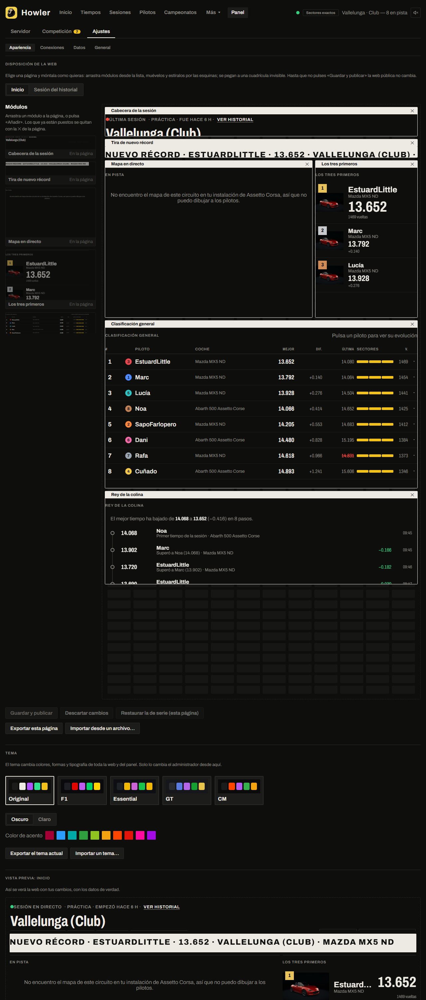

You decide the theme and layout: visitors can't change them. Both can be exported and imported as files (`howler-theme`, `howler-layout`) to share.

## How to change language, time and units

1. Open **Settings → General**.
2. Under **Language, time and units of the website**, choose the language, time format (24 h/12 h), date order and metric or imperial.

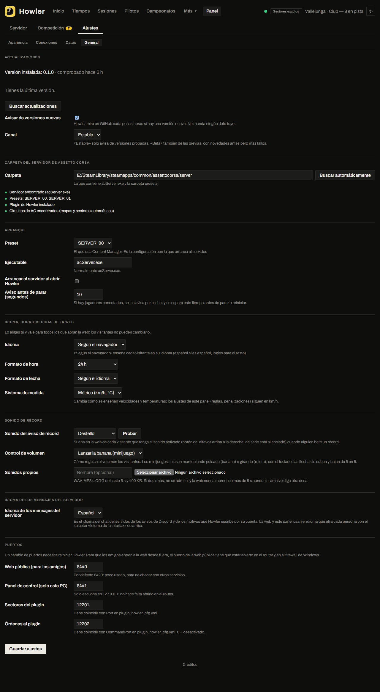

It applies to every visitor. Data is always stored in km/h and °C; only what is displayed changes. The panel stays in km/h and km.

## How to make and restore backups

1. Open **Settings → Data → Backups**.
2. Howler makes an automatic backup every day and keeps the last 7 (`backup.everyDays`, `backup.keep`).
3. For one now, click **Back up now**. To take it off the PC, download it.
4. To restore, pick the backup and click **Restore**: it is applied on restart and the previous data is saved to `data\antes-de-restaurar\<date>`.

You can also export all laps as CSV or JSON (the CSV opens in Excel; it carries no Steam ID).

## How to turn on advanced telemetry

*Real brake, g-forces, wheel slip, ABS/TC and tyres in the comparer. Experimental.*

1. In `<server>\cfg\plugin_howler_cfg.yml`, set `ClientTelemetry: true`.
2. In `extra_cfg.yml`, check `EnableClientMessages: true`.
3. Restart the **server** (restarting the game isn't enough).

Players **install nothing**: the server hands out a script that their CSP downloads on its own. Anyone without CSP keeps the old behaviour (brake on/off).

> **Important.** This data comes from each player's PC and can be tampered with: it's good for statistics, not for penalties. Tyre temperatures and pressures are only reliable on cars with their own thermal model; some mods leave them fixed.

## How to update and uninstall

- **Update:** the panel tells you when there is a new version. Click **Update** (or **Not now** if you prefer to wait). Your data and configuration are kept. It installs by itself only if the release ships an installer and its checksum; otherwise the button opens the release page.
- **Uninstall:** **Windows Settings → Apps → Howler**. By default your data and configuration are **kept**; the wizard asks whether to delete them.

---

# 3. If something goes wrong

Each entry: what you see → what causes it → what to do.

## The server won't start

| You see | Cause | What to do |
|---|---|---|
| The panel warns about `data.acd` or “checksum” | A car in the list has no data file on the server | Click **Allow cars without data.acd (recommended)**, or remove the car from the list |
| “track params” | That track has no parameters in AssettoServer | `IgnoreConfigurationErrors.MissingTrackParams: true` in `extra_cfg.yml` (may offset the time with WeatherFX) |
| “WrongServerDetails” | In Content Manager the extra-details mode is not compatible | *Server → Details*: don't use “Via ID in the name” |
| “Unsafe admin whitelist” | You have Steam-ID admins without Steam Auth | Turn on Steam Auth |
| Port in use | Another server is still open | Close it or change the ports |

> **Careful.** *Allow cars without data.acd* lets a player modify their car.

## The website doesn't open from outside

Check in this order:

1. `http://localhost:8420` opens on your PC. If not, Howler isn't running.
2. `http://LOCAL-IP:8420` opens from a phone on your wifi.
3. The firewall has port 8420 open.
4. The router forward points to the **right local IP**.
5. Your provider doesn't block home hosting or use CGNAT. If it does, use a tunnel.
6. **If you have two routers** (a main one and a second one behind it, where your PC is connected): the main router's port forward must point to the address **the main router uses to see the second one**, not to your PC's own IP. That is the same address you already use for other servers that work from your PC. And the second router must send the traffic on to your PC (DMZ or its own forward). To check: open `http://THAT-ADDRESS:8420` from your PC; if it loads, the address is right.

## Nobody sees the server in the list

Try connecting with the IP and HTTP port from Content Manager. If that works, the lobby registration is failing (`REGISTER_TO_LOBBY=1`). If not, it's the ports or firewall of the **game server** (check yours in `server_cfg.ini`: `UDP_PORT`, `TCP_PORT`, `HTTP_PORT`).

## “No slots” when joining

`MAX_CLIENTS` is higher than the number of cars in the list, or the car name doesn't match. Check **Server cars**.

## No exact sectors

The plugin isn't loaded. Check that the **Exact sectors** indicator in the header is on, that `EnablePlugins: [HowlerPlugin]` is in `extra_cfg.yml`, and restart the server. Without the plugin sectors are an estimate (in italics).

## No lap times show up

- Check that `UDP_PLUGIN_ADDRESS` (`127.0.0.1:12000`) and `UDP_PLUGIN_LOCAL_PORT` (`11000`) are in the preset's `server_cfg.ini` and that `EnableLegacyPluginInterface: true` is in `extra_cfg.yml`.
- Check that the ports in `howler.config.json` (`acsp`) match.
- A lap with cuts may be voided: look in **Competition → Lap rules**.

## The map is missing or rotated

Howler draws the map from the track files of your Assetto Corsa install (`content\tracks`). If the track isn't on the server PC there is no map. Rotated maps fix themselves when the track ships its AI line (`ai\fast_lane.ai`).

## The record sound doesn't play

It is off by default and each visitor turns it on with the speaker in the header. Browsers don't allow sound until the person has clicked something on the page.

## Discord notifications don't arrive

Click **Test** in **Settings → Connections → Discord**. If it fails, the webhook link was copied wrongly or the channel deleted it. The link must start with `https://discord.com/api/webhooks/`.

## MultiHowler won't connect

- **Your website address** must be Howler's website (public IP and port 8420), not the game server's.
- At least one of the two must be reachable from the internet.
- Both Howlers must be on.
- Look at the link status: it shows when it last synced, or the error.

## Howler doesn't close completely

Open Task Manager and end `Howler.exe`. If it happens often, keep `data\howler.log` and ask for help.

## Asking for help

Include Howler's version (**Settings → General**), what you were doing, what you expected, what happened, and `data\howler.log`. **Don't include** webhook links or link keys.

---

# 4. Reference

Facts only, no explanations.

## Ports

| Port | Protocol | Who | Open to outside? |
|---|---|---|---|
| 8420 | TCP | Public website | Yes, if you want to share it |
| 8421 | TCP | Panel (127.0.0.1 only) | **No** |
| 12000 / 11000 | UDP | Howler ↔ AC server (local) | No |
| 12001 / 12002 | UDP | Howler ↔ plugin (local) | No |
| The ones in your `server_cfg.ini` | UDP/TCP | AC server with the players | Yes (opened by whoever runs the server) |

## Folders

```
Howler\
  Howler.exe
  howler.config.json      Your configuration
  data\                   Database, backups, avatars, images, sounds, log (howler.log)
  web\  plugin\  app\     Program (replaced on update)
```

## howler.config.json

Every key is optional: anything missing takes its default. If something isn't valid, Howler doesn't save the change. Most of these settings are changed from the panel.

| Key | What it does | Default |
|---|---|---|
| `serverDir` | AC server folder | empty |
| `language` | Language of what Howler writes (chat, Discord): `es` or `en` | `es` |
| `http.host` / `http.port` | Where the website listens | `0.0.0.0` / `8420` |
| `admin.port` | Panel port (127.0.0.1 only) | `8421` |
| `dataDir` | Data folder | `./data` |
| `server.exe` | Server executable | `acServer.exe` |
| `server.preset` | Content Manager preset to start with | `SERVER_00` |
| `server.startWithHowler` | Start the server with Howler | `false` |
| `server.stopWarningSeconds` | Warning seconds before stopping | `10` |
| `acsp.listenHost` / `acsp.listenPort` | Where Howler listens to the server (`UDP_PLUGIN_ADDRESS`) | `127.0.0.1` / `12000` |
| `acsp.serverHost` / `acsp.serverPort` | Where the server listens (`UDP_PLUGIN_LOCAL_PORT`) | `127.0.0.1` / `11000` |
| `acsp.positionIntervalMs` | Position interval | `100` |
| `acsp.referenceOffsetM` | Calibration of the sector estimate (no plugin) | `1` |
| `acsp.pluginPort` | Port where Howler listens to the plugin | `12001` |
| `acsp.pluginCommandPort` | The plugin's command channel (0 = none) | `12002` |
| `profiles.steamAvatars` | Download the Steam profile picture | `true` |
| `lapRules` | Valid-lap profiles and their per-track assignment | `cortes` profile |
| `racePenalties` | Automatic seconds per cut and collision (all 0 = off) | `0` |
| `discord` | Webhooks, announcements and texts | off |
| `recordAnnounce` | Record announcements in the server chat | off |
| `appearance` | Theme, layout and website format | built-in |
| `backup.auto` / `everyDays` / `keep` | Automatic backups | `true` / `1` / `7` |
| `updates.check` / `channel` / `repo` | Version notices (`stable` or `beta`) | `true` / `stable` |
| `trackSectors` | Manual sectors for a track (exceptions only) | `{}` |

## plugin_howler_cfg.yml

Created by itself in `<server>\cfg\` the first time and never rewritten.

| Key | What it does | Default |
|---|---|---|
| `Host` | Where Howler listens | `127.0.0.1` |
| `Port` | Sector port (= `acsp.pluginPort`) | `12001` |
| `TelemetryHz` | Samples per second per car (0 = off) | `10` |
| `CommandPort` | Panel commands (127.0.0.1 only; 0 = off) | `12002` |
| `ClientTelemetry` | Extra data from players with CSP (experimental) | `false` |

## What Howler touches on your server

Always with a `.howler-prev` copy next to the original:

- Preset `server_cfg.ini`: fuel, damage, tyre wear, track, `CARS`, `MAX_CLIENTS`, plugin ports.
- `entry_list.ini`: the car list.
- `extra_cfg.yml`: `EnableWeatherFx`, `EnableLegacyPluginInterface`, `EnablePlugins`, `IgnoreConfigurationErrors`.
- Cars' `data.acd`: reversibly renamed to `data.acd.howler-off` (with the server stopped).

## Public API (read-only)

The website uses these routes; you can use them for your own modules. They carry no Steam ID.

`/api/status` · `/api/combos` · `/api/records` · `/api/records/latest` · `/api/timing` · `/api/laps/recent` · `/api/sessions` · `/api/sessions/:id/timing` · `/api/drivers` · `/api/drivers/:id` · `/api/tracks` · `/api/cars` · `/api/rankings` · `/api/championships` · `/api/compare` · `/api/replay` · `/api/live` (live events) · `/api/map` · `/api/positions`

The panel uses `/admin/api/*`, only from 127.0.0.1:8421 and with the `X-Howler-Admin: 1` header.

## Database

`data\howler.db` (SQLite). Main tables: `drivers`, `sessions`, `laps`, `lap_sectors`, `lap_incidents`, `lap_traces`, `championships` (and `championship_*`), `penalties`, `imports`, `mh_*`. For your own queries open it **read-only** with Howler stopped, or use a copy.

## Formats

- `howler-theme`: `#rrggbb` colors, 8 chart colors, shape (`rounded|capsule|square`), texture, typography, motion and density. An unknown field invalidates the theme.
- `howler-layout`: per page, a list of modules with an `x, y, w, h` rectangle on a 12-column grid.

Both are exported and imported from **Settings → Appearance**, with a preview before applying.

## Manual installation

For people who don't use the installer.

1. Upgrade the server to **AssettoServer v0.0.55-pre35** (0.0.54 ignores sectors). Change `REVERSED_GRID_RACE_POSITIONS=-1` to `0` if you have it.
2. Copy `plugin\HowlerPlugin` to `<server>\plugins\HowlerPlugin\`.
3. In `extra_cfg.yml`: `EnableLegacyPluginInterface: true`, `EnablePlugins: [HowlerPlugin]` and, if needed, `IgnoreConfigurationErrors.MissingTrackParams: true`.
4. In the preset's `server_cfg.ini`: `UDP_PLUGIN_ADDRESS=127.0.0.1:12000` and `UDP_PLUGIN_LOCAL_PORT=11000`.
5. Copy `howler.config.example.json` to `howler.config.json` and set `serverDir`.
6. Open port 8420 in the firewall if you want to share the website.
7. Start `Howler.exe`.

To go back, restore the copy in `howler-backup\` with the server stopped.

---

# 5. Why it works this way

- **Sectors.** The Assetto Corsa server only gives the lap time. With the plugin, Howler receives **exact** sectors; without it, it computes them from the car's position (an estimate, about ±10–25 ms, shown in italics).
- **Valid, void or pending lap.** One single function always decides. It only uses saved data (time, cuts, collisions with their speed), which is why you can change the rules and recalculate the whole history.
- **Client data.** Real brake, g and tyres come from each player's PC. They can be tampered with: good for statistics, not for penalties.
- **Identity.** Each driver is identified by their Steam ID, which **never** leaves through the website or the API.
- **MultiHowler.** Each Howler stores a full copy. Each lap is only modified by the Howler where it was born, so there are no conflicts. There is no relay: to have C's data you must link with C.
- **Local-only panel.** The panel can start and stop the server, so it listens only on 127.0.0.1 and rejects requests from other websites.
- **Privacy.** Howler only contacts the internet for Discord announcements, updates (GitHub) and Steam profile pictures. Each can be turned off.
- **No code signing.** There is no paid certificate, which is why Windows warns about an “unknown publisher”.

---

# 6. Appendices

## Glossary

| Term | What it is |
|---|---|
| **AssettoServer** | The game server you use; an improved alternative to Kunos' |
| **Combination** | A track with a car (records are per combination) |
| **CSP** | Custom Shaders Patch, a mod for the Assetto Corsa client |
| **Plugin** | A piece loaded inside the server |
| **Preset** | A Content Manager server configuration folder |
| **Session** | One practice, qualifying or race |
| **UDP / TCP** | Two ways of sending data over a network; each port uses one |
| **Webhook** | A link that lets Howler write to a Discord channel |
| **WeatherFX** | CSP's weather system (Pure, Sol) |

## Check that the installer is authentic

In PowerShell, in the download folder:

```powershell
Get-FileHash Howler-Setup.exe -Algorithm SHA256
```

Compare the result with the one in `SHA256SUMS` on the release page. They must be identical.

## Migrate from AssettoServer 0.0.54 to 0.0.55-pre35

The installer does it by itself, with a backup in `howler-backup\`. To undo it, from the source code:

```powershell
npm run migrate -w @howler/installer -- --server "<folder>" --rollback
```

Third-party plugins compiled for the old version may fail to load.

## License, trademark and credits

Howler is free but not open source: see `LICENSE`. The name and logo are reserved (`docs/TRADEMARK.md`). `HowlerPlugin` is AGPL-3.0, like AssettoServer, whose source is available from its project. Third-party components and the badge icons (Game-icons.net, CC BY 3.0) are in `THIRD-PARTY-NOTICES.md` and on the website's credits page.

## Known limitations

- The first lap after connecting has no sectors.
- Without the plugin, sectors are an estimate.
- The server keeps no official results: race positions are rebuilt from laps.
- Tyre data is only reliable on cars with a thermal model.
- Only each driver's best lap can be compared and replayed.
- The panel has no mobile version.
- Championships from linked Howlers don't bring skins, weather or schedule.
