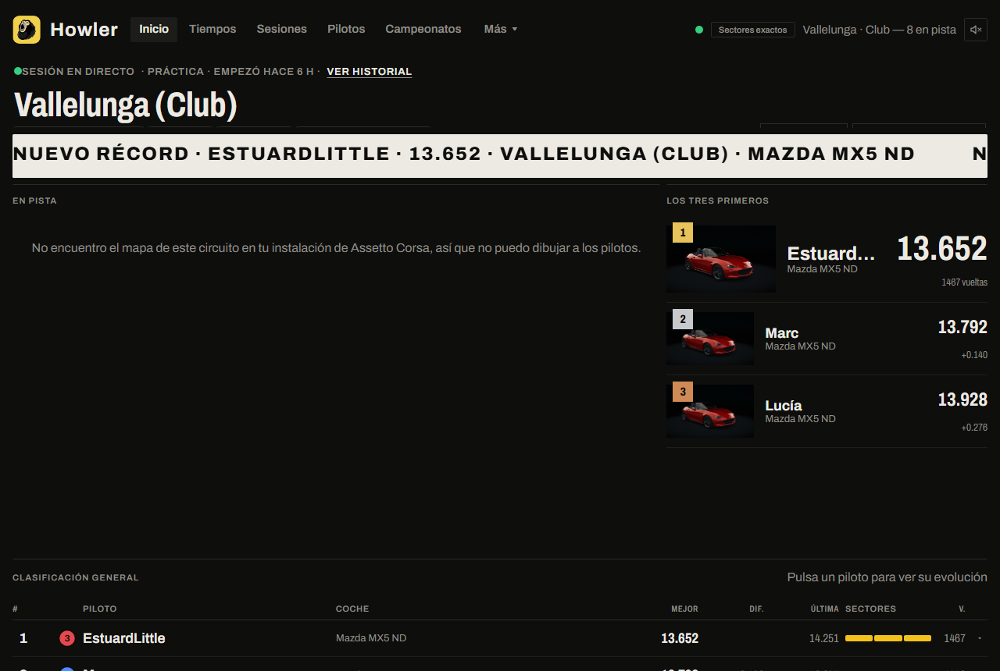

# Manual de Howler

*[English version](MANUAL.en.md)*

Howler guarda los tiempos de tu servidor de Assetto Corsa y los enseña en una web: clasificaciones, récords, fichas de piloto, comparador de vueltas y campeonatos. También controla el servidor desde un panel. Sustituye a stracker.

**Cómo leer este manual.** No hace falta leerlo entero:

| Quiero… | Ve a |
|---|---|
| Instalar Howler y ver mi primer tiempo | [1. Empieza aquí](#1-empieza-aquí) |
| Hacer una tarea concreta (campeonato, Discord, copias…) | [2. Cómo…](#2-cómo) |
| Arreglar algo que no funciona | [3. Si algo falla](#3-si-algo-falla) |
| Consultar un ajuste, un puerto o una carpeta | [4. Referencia](#4-referencia) |
| Entender por qué funciona así | [5. Por qué funciona así](#5-por-qué-funciona-así) |

Convenciones: **Botón** = algo que pulsas · `código` = algo que escribes o un archivo · **Importante**, **Consejo** y **Cuidado** (este último, solo si algo puede romperse o perder datos).

---

# 1. Empieza aquí

## Qué es Howler (y qué no)

Howler **no** es un servidor de juego: usa el tuyo. Se instala en el mismo PC que el servidor de Assetto Corsa, escucha lo que pasa en él (vueltas, choques, sesiones) y lo guarda en una base de datos propia. Con eso monta la web y el panel.

Tiene tres piezas:

- **La web** (puerto 8420): la ve cualquiera a quien se la enseñes. Solo lee datos.
- **El panel** (puerto 8421): solo se abre desde el propio PC. Aquí arrancas el servidor, cambias reglas y montas campeonatos.
- **El plugin** (`HowlerPlugin`): una pieza pequeña que se instala dentro del servidor y le da a Howler los sectores exactos. Sin él, Howler funciona, pero los sectores son una estimación.

## Qué necesitas

| Necesitas | Detalle |
|---|---|
| Windows 10 u 11 | El mismo PC donde corre el servidor de Assetto Corsa |
| Un servidor de Assetto Corsa | Creado con Content Manager. El instalador puede actualizarlo a AssettoServer por ti |
| 5 minutos | El instalador hace una copia de seguridad antes de tocar nada |
| Opcional: CSP en los jugadores | Solo para el clima avanzado (Pure/Sol) y la telemetría extra |

## Instalar

1. Descarga `Howler-Setup.exe` de la página de descargas.
2. Ábrelo. Si Windows muestra **«Windows protegió su PC»**, pulsa **Más información → Ejecutar de todas formas**. Sale porque el instalador no lleva firma de pago, no porque sea peligroso; puedes [comprobar que es auténtico](#comprobar-que-el-instalador-es-auténtico).
3. Se abre una ventana de instalación. Elige el idioma y acepta la licencia.
4. Elige cómo instalar:
   - **Usar mi servidor actual** (recomendado si Howler lo encuentra). Howler lo detecta, hace una copia de seguridad en `howler-backup\` y lo prepara.
   - **Hacer una copia en otra carpeta.** Copia tu servidor a otro sitio y deja el original intacto.
   - **Crear un servidor nuevo para mí.** Solo sale si tienes Assetto Corsa y ningún servidor. Howler monta uno listo para usar (AssettoServer, un circuito y un coche de serie) y lo conecta con Howler. Después lo cambias desde el panel.
   - **Solo instalar Howler.** No toca ningún servidor; lo añades después desde el panel o con la [instalación manual](#instalación-manual). Si Howler no encuentra ningún servidor, esta es la opción que propone.
5. Elige el **tipo de instalación**:
   - **Completa** (recomendada): abre el puerto de la web (8420) en el cortafuegos para que tus pilotos la vean. Pide un permiso de administrador.
   - **Sin abrir puertos:** no toca el cortafuegos ni abre ningún puerto; la web solo funciona en este PC. Puedes abrir el puerto después con [esta guía](#cómo-enseñar-la-web-a-tus-pilotos).
   - **Personalizada:** eliges cada opción (cortafuegos, accesos directos, arrancar con Windows). Debajo ves **qué va a pasar** exactamente.
6. Pulsa **Instalar**. Al terminar se abre Howler y la última pantalla te enseña la **dirección de tu web** con botón de copiar.

AssettoServer (versión 0.0.55-pre35) va **dentro del instalador**: no hace falta descargar nada.

> **Importante.** Instala solo para tu usuario (`%LOCALAPPDATA%\Programs\Howler`), sin administrador. Solo abrir el cortafuegos pide permiso, y es opcional.

> **Cuidado.** El instalador se niega a continuar si `Howler.exe` o el servidor están en marcha. Ciérralos antes.

## Ver tu primer tiempo

1. En el panel, abre **Servidor → Estado y consola** y pulsa **Arrancar**.
2. Espera a que el indicador de arriba a la derecha se ponga verde.
3. Entra al servidor con Assetto Corsa y da una vuelta completa.
4. Abre la web: `http://localhost:8420`.


*Debería verse:* tu nombre en **Inicio**, con el tiempo de la vuelta.



> **Consejo.** La primera vuelta tras entrar no tiene sectores (Howler no vio la salida). Las siguientes sí.

Si el servidor lo arrancaste desde Content Manager, el panel dice **«En marcha (no lo arrancó Howler)»**: funciona igual, pero desde el panel no se puede parar de forma limpia. Para eso, arráncalo siempre desde Howler.

---

# 2. Cómo…

Cada guía dice para qué sirve, cuánto tarda y qué necesitas. Si un paso no sale como dice «Debería verse…», mira [Si algo falla](#3-si-algo-falla).

## Cómo enseñar la web a tus pilotos

*Para que cualquiera pueda ver los tiempos desde su casa. 15 minutos.*

**Necesitas:** acceso a la configuración de tu router.

1. Averigua la IP local de tu PC: en el panel, **Ajustes → General → Dirección de tu web** ya la enseña (con botón de copiar). Si no, pulsa **Windows + R**, escribe `cmd`, Intro, y luego `ipconfig`: mira **Dirección IPv4**.
2. En tu router, redirige el puerto **TCP 8420** a esa IP.
3. Abre el puerto **8420** en el cortafuegos de Windows (el tipo de instalación **Completa** lo hace; con **Sin abrir puertos** tendrás que hacerlo tú).
4. Busca «mi IP» en internet para saber tu IP pública.
5. Desde un móvil **sin wifi**, abre `http://TU-IP-PÚBLICA:8420`.

*Debería verse:* la web de Howler.

> **Cuidado.** El **panel** (puerto 8421) solo funciona en tu PC. No lo abras al exterior.

> **Consejo.** Si tu operador no te da una IP pública propia (CGNAT), usa un túnel (por ejemplo Cloudflare Tunnel) en lugar de abrir puertos.

## Cómo arrancar, parar y reiniciar el servidor

1. Abre **Servidor → Estado y consola**.
2. Pulsa **Arrancar**, **Parar** o **Reiniciar**.

Al parar, Howler avisa por chat a los jugadores (10 s por defecto; se cambia en `server.stopWarningSeconds`) y cierra el servidor de forma limpia. Al cerrar Howler, para el servidor que él arrancó.

Para que el servidor arranque solo con Howler, pon `server.startWithHowler` a `true`.

## Cómo cambiar coches, skins y circuito

1. Abre **Servidor → Sesión y clima**.
2. En **Coches del servidor**, pulsa **+ Añadir coches** y elige coche y skin. Los selectores enseñan vistas previas y se pueden filtrar.
3. Mira el contador `coches/boxes`: no puede haber más coches que plazas del circuito (los espectadores no cuentan).
4. Para cambiar de circuito, pulsa **Cambiar circuito** en el bloque Circuito.
5. Pulsa **Guardar** y reinicia el servidor.


Si tienes campeonatos, también puedes asignar a cada plaza un equipo y un piloto reservado.

> **Importante.** Howler guarda una copia de cada archivo que toca (`.howler-prev`). Si luego guardas desde Content Manager, manda Content Manager.

## Cómo cambiar la hora, el clima y la sesión en directo

1. Abre **Servidor → En directo**.
2. Mueve el deslizador de la hora (o escribe la hora) y elige un clima.
3. Con el servidor en marcha, el cambio es inmediato.


Aquí también: siguiente sesión, reiniciar sesión, mensaje al chat, expulsar, banear, lastre y restrictor.

Hay dos sistemas de clima, y se elige en **Servidor → Sesión y clima → Sistema de clima**:

- **Clásico**: la lista de climas del preset (`[WEATHER_n]`). Funciona con cualquier cliente.
- **CSP WeatherFX**: para Pure o Sol. Cada jugador elige su script en su Content Manager, y el servidor solo manda el *tipo* de clima. Necesita CSP en los clientes.

> **Cuidado.** Howler no reparte ni incluye archivos de Pure (su licencia lo prohíbe): solo los detecta y configura el servidor.

## Cómo decidir qué vueltas valen

1. Abre **Competición → Reglas de vuelta**.
2. Elige un perfil: **Solo cortes** (de serie: salirse de pista anula), **Estándar** (también choques fuertes) o **Estricto (como stracker)** (cualquier choque), o crea el tuyo. Puedes asignar un perfil distinto a cada circuito.
3. Pulsa **Probar con el historial**: ves cuántas vueltas cambiarían, sin tocar nada.
4. Pulsa **Guardar** (solo vueltas nuevas) o **Guardar y recalcular el historial**.


Una vuelta puede ser **válida**, **nula** o **pendiente de revisión**. Las pendientes son salidas de boxes: no cuentan hasta que las apruebas en la tarjeta **Pendientes de revisión**. También puedes anular o dar por buena cualquier vuelta reciente, con un motivo.

Con **Avisar al piloto**, Howler escribe por chat «Howler: vuelta X anulada» con el motivo.

## Cómo penalizar a un piloto en una carrera

1. Abre **Competición → Penalizaciones**.
2. Elige la sesión y el piloto.
3. Elige **Aviso** (solo se guarda), **Tiempo añadido** (segundos) o **Descalificar**, y escribe el motivo.
4. Marca **Avisar por el chat del servidor** si quieres que lo vea el servidor.


También hay penalizaciones **automáticas** (segundos por corte y por choque), apagadas de serie. Cuentan solo en el resultado de las carreras de campeonato; no cambian la tabla de tiempos.

## Cómo montar un campeonato

*30 minutos la primera vez.*

1. Abre **Competición → Campeonatos → + Nuevo campeonato**.
2. **Tipo:** nombre, formato (individual, parejas, equipos) e imagen (se sube desde tu PC).
3. **Participantes:** elige pilotos del servidor. A quien nunca ha entrado, añádelo pegando el enlace de su perfil de Steam; se enlazará cuando se conecte.
4. **Carreras:** circuito, coches permitidos, horarios (práctica, clasificación, carrera…), clima y mods con su enlace de descarga.
5. **Puntuación:** elige una plantilla (F1, solo ganar, más vueltas…) y ajústala.
6. **Resumen:** revisa, elige el estado **Activo** (visible en la web) y guarda. Con **Borrador** no se ve fuera del panel.


Las carreras se asignan solas cuando una sesión coincide con la siguiente carrera pendiente. Si hay duda, queda en **Sesiones por confirmar**. Un campeonato creado *después* de las sesiones no las asigna solo: confírmalas a mano.

La web pública los enseña en **Campeonatos**.


> **Consejo.** Los resultados de carrera se reconstruyen con las vueltas guardadas (el servidor no guarda resultados oficiales): gana quien más vueltas da y, a igualdad, el menor tiempo total más penalizaciones.

## Cómo importar el historial de stracker

1. Abre **Ajustes → Datos → Importar**.
2. Sube tu archivo `.db3` de stracker (se abre siempre en solo lectura).
3. Revisa los jugadores (enlázalos con los de Howler si ya existen) y los circuitos.
4. Pulsa **Importar**. Puedes repetirlo: no duplica.


stracker no guarda sectores ni el Steam ID real, así que los pilotos importados pueden necesitar unirse a mano con el real (**Ajustes → Datos → Pilotos**). La validez de cada vuelta la decide Howler con tus reglas, no stracker.

## Cómo avisar en Discord

1. En Discord: **Ajustes del canal → Integraciones → Webhooks → Nuevo webhook → Copiar URL**.
2. En Howler: **Ajustes → Conexiones → Discord**, pega la URL y pulsa **Probar**.
3. Activa los avisos que quieras (récords, servidor encendido, campeonato nuevo…) y cambia su texto si quieres.

Cada aviso tiene botón **Probar este aviso**. Puedes añadir hasta 10 canales.

## Cómo avisar de récords en el chat del servidor

1. Abre **Servidor → En directo** y baja a **Avisar de récords en el chat del servidor**.
2. Marca qué récords anunciar: mejor vuelta de la sesión, de circuito y coche, o absoluto del circuito.
3. Cambia el texto si quieres (`{piloto}`, `{tiempo}`, `{coche}`, `{circuito}`, `{anterior}`, `{mejora}`).

## Cómo vincular dos Howler (MultiHowler)

*Para compartir tiempos entre dos servidores sin base de datos común. 10 minutos.*

1. En el Howler A: **Ajustes → Conexiones → MultiHowler**. Rellena **Dirección de tu web** y pulsa **Copiar invitación**.
2. Envía la invitación a la otra persona.
3. En el Howler B, pega la invitación en **Vincular con otro Howler** y elige si quieres recibir, dar o ambas.
4. En A aparece una solicitud: **Aprobar** con los permisos que quieras.


Los datos solo viajan de A a B si A da **y** B recibe. Cada vínculo muestra cuándo fue la última sincronización. Puedes **ocultar** los datos de un vínculo (reversible) o **borrarlos**.

> **Importante.** Basta con que uno de los dos sea accesible desde internet, pero los dos Howler deben estar encendidos para sincronizar. Lo mejor es que Howler arranque con Windows.

## Cómo cambiar el aspecto de la web

1. Abre **Ajustes → Apariencia**.
2. **Tema:** elige uno de serie (Original, F1, Essential, GT, CM), un color de acento, o importa uno.
3. **Disposición:** arrastra, estira o quita los módulos de cada página.
4. Pulsa **Guardar y publicar**.


El tema y la disposición los decides tú: el visitante no los cambia. Se pueden exportar e importar como archivo (`howler-theme`, `howler-layout`) para compartirlos.

## Cómo cambiar idioma, hora y unidades

1. Abre **Ajustes → General**.
2. En **Idioma, hora y medidas de la web**, elige idioma, formato de hora (24 h/12 h), orden de fecha y sistema métrico o imperial.


Afecta a todos los visitantes. Los datos se guardan siempre en km/h y °C; solo cambia lo que se enseña. El panel sigue en km/h y km.

## Cómo hacer y restaurar copias de seguridad

1. Abre **Ajustes → Datos → Copias y exportar**.
2. Howler guarda una copia automática cada día y conserva las 7 últimas (`backup.everyDays`, `backup.keep`).
3. Para una copia ahora, pulsa **Crear copia ahora**. Para sacarla del PC, descárgala.
4. Para restaurar, elige la copia y pulsa **Restaurar**: se aplica al reiniciar y lo anterior se guarda en `data\antes-de-restaurar\<fecha>`.

También puedes exportar todas las vueltas como CSV o JSON (el CSV se abre en Excel; no lleva Steam ID).

## Cómo activar la telemetría avanzada

*Freno real, fuerzas g, patinazos, ABS/TC y neumáticos en el comparador. Experimental.*

1. En `<servidor>\cfg\plugin_howler_cfg.yml`, pon `ClientTelemetry: true`.
2. En `extra_cfg.yml`, comprueba `EnableClientMessages: true`.
3. Reinicia el **servidor** (no basta con reiniciar el juego).

Los jugadores **no instalan nada**: el servidor reparte un script que su CSP descarga solo. Quien no tenga CSP sigue con lo de antes (freno encendido/apagado).

> **Importante.** Estos datos salen del PC de cada jugador y se pueden manipular: valen para estadísticas, no para sancionar. Las temperaturas y presiones de neumáticos solo son fiables en coches con modelo térmico propio; algunos mods las dejan fijas.

## Cómo actualizar y desinstalar

- **Actualizar:** el panel avisa cuando hay una versión nueva. Pulsa **Actualizar ahora**. Tus datos y tu configuración se conservan. Solo se instala sola si la versión trae instalador y su suma de comprobación; si no, el botón lleva a la página de la versión.
- **Desinstalar:** **Configuración de Windows → Aplicaciones → Howler**. Por defecto **se conservan** tus datos y configuración; el asistente pregunta si quieres borrarlos.

---

# 3. Si algo falla

Cada entrada: lo que ves → qué lo causa → qué hacer.

## El servidor no arranca

| Ves | Causa | Qué hacer |
|---|---|---|
| El panel avisa de `data.acd` o «checksum» | Un coche de la lista no tiene su archivo de datos en el servidor | Pulsa **Permitir coches sin data.acd (recomendado)**, o quita el coche de la lista |
| «track params» | Ese circuito no tiene parámetros en AssettoServer | `IgnoreConfigurationErrors.MissingTrackParams: true` en `extra_cfg.yml` (puede desajustar la hora con WeatherFX) |
| «WrongServerDetails» | En Content Manager, el modo de detalles extra no es compatible | *Servidor → Detalles*: no uses «Vía ID en el nombre» |
| «Unsafe admin whitelist» | Tienes administradores por Steam ID sin Steam Auth | Activa Steam Auth |
| Puerto en uso | Otro servidor sigue abierto | Ciérralo o cambia los puertos |

> **Cuidado.** *Permitir coches sin data.acd* deja que un jugador modifique su coche.

## La web no abre desde fuera

Comprueba en este orden:

1. `http://localhost:8420` abre en tu PC. Si no, Howler no está en marcha.
2. `http://IP-LOCAL:8420` abre desde un móvil con wifi.
3. El cortafuegos tiene abierto el puerto 8420.
4. La redirección del router apunta a la **IP local correcta**.
5. Tu operador no bloquea el alojamiento en casa ni usa CGNAT. Si lo hace, usa un túnel.

## Nadie ve el servidor en la lista

Prueba a conectar con la IP y el puerto HTTP desde Content Manager. Si así funciona, falla el registro en la lista (`REGISTER_TO_LOBBY=1`). Si no, son los puertos o el cortafuegos del **servidor de juego** (consulta los de tu `server_cfg.ini`: `UDP_PORT`, `TCP_PORT`, `HTTP_PORT`).

## «No hay plazas» al entrar

`MAX_CLIENTS` es mayor que el número de coches de la lista, o el nombre del coche no coincide. Revisa **Coches del servidor**.

## No salen sectores exactos

El plugin no está cargado. Comprueba que el indicador **Sectores exactos** de la cabecera está activo, que `EnablePlugins: [HowlerPlugin]` está en `extra_cfg.yml`, y reinicia el servidor. Sin plugin los sectores son una estimación (en cursiva).

## No sale ningún tiempo

- Comprueba que `UDP_PLUGIN_ADDRESS` (`127.0.0.1:12000`) y `UDP_PLUGIN_LOCAL_PORT` (`11000`) están en el `server_cfg.ini` del preset y que `EnableLegacyPluginInterface: true` está en `extra_cfg.yml`.
- Comprueba que los puertos de `howler.config.json` (`acsp`) coinciden.
- Una vuelta con cortes puede estar anulada: míralo en **Competición → Reglas de vuelta**.

## Falta el mapa o sale girado

Howler dibuja el mapa con los archivos del circuito de tu instalación de Assetto Corsa (`content\tracks`). Si el circuito no está en el PC del servidor, no hay mapa. Los mapas girados se corrigen solos cuando el circuito trae su línea de IA (`ai\fast_lane.ai`).

## No suena el sonido de récord

Viene apagado de serie y cada visitante lo activa con el altavoz de la cabecera. Los navegadores no permiten sonar hasta que la persona haya pulsado algo en la página.

## No llegan avisos a Discord

Pulsa **Probar** en **Ajustes → Conexiones → Discord**. Si falla, el enlace del webhook está mal copiado o el canal lo borró. El enlace debe empezar por `https://discord.com/api/webhooks/`.

## MultiHowler no conecta

- La **Dirección de tu web** debe ser la web de Howler (IP pública y puerto 8420), no la del servidor de juego.
- Al menos uno de los dos debe ser alcanzable desde internet.
- Los dos Howler tienen que estar encendidos.
- Mira el estado del vínculo: dice cuándo fue la última sincronización o el error.

## Howler no cierra del todo

Abre el Administrador de tareas y finaliza `Howler.exe`. Si pasa a menudo, guarda `data\howler.log` y pide ayuda.

## Pedir ayuda

Incluye la versión de Howler (**Ajustes → General**), qué hacías, qué esperabas, qué pasó y `data\howler.log`. **No incluyas** enlaces de webhooks ni claves de vinculación.

---

# 4. Referencia

Solo hechos, sin explicaciones.

## Puertos

| Puerto | Protocolo | Quién | ¿Al exterior? |
|---|---|---|---|
| 8420 | TCP | Web pública | Sí, si quieres compartirla |
| 8421 | TCP | Panel (solo 127.0.0.1) | **No** |
| 12000 / 11000 | UDP | Howler ↔ servidor de AC (local) | No |
| 12001 / 12002 | UDP | Howler ↔ plugin (local) | No |
| Los de tu `server_cfg.ini` | UDP/TCP | Servidor de AC con los jugadores | Sí (los abre quien monta el servidor) |

## Carpetas

```
Howler\
  Howler.exe
  howler.config.json      Tu configuración
  data\                   Base de datos, copias, avatares, imágenes, sonidos, registro (howler.log)
  web\  plugin\  app\     Programa (se reemplaza al actualizar)
```

## howler.config.json

Todas las claves son opcionales: lo que falte toma su valor por defecto. Si algo no es válido, Howler no guarda el cambio. La mayoría de estos ajustes se cambian desde el panel.

| Clave | Qué hace | Por defecto |
|---|---|---|
| `serverDir` | Carpeta del servidor de AC | vacío |
| `language` | Idioma de lo que escribe Howler (chat, Discord): `es` o `en` | `es` |
| `http.host` / `http.port` | Dónde escucha la web | `0.0.0.0` / `8420` |
| `admin.port` | Puerto del panel (solo 127.0.0.1) | `8421` |
| `dataDir` | Carpeta de datos | `./data` |
| `server.exe` | Ejecutable del servidor | `acServer.exe` |
| `server.preset` | Preset de Content Manager con el que arrancar | `SERVER_00` |
| `server.startWithHowler` | Arrancar el servidor con Howler | `false` |
| `server.stopWarningSeconds` | Segundos de aviso antes de parar | `10` |
| `acsp.listenHost` / `acsp.listenPort` | Dónde escucha Howler al servidor (`UDP_PLUGIN_ADDRESS`) | `127.0.0.1` / `12000` |
| `acsp.serverHost` / `acsp.serverPort` | Dónde escucha el servidor (`UDP_PLUGIN_LOCAL_PORT`) | `127.0.0.1` / `11000` |
| `acsp.positionIntervalMs` | Intervalo de posiciones | `100` |
| `acsp.referenceOffsetM` | Calibración de la estimación de sectores (sin plugin) | `1` |
| `acsp.pluginPort` | Puerto donde escucha Howler al plugin | `12001` |
| `acsp.pluginCommandPort` | Canal de órdenes del plugin (0 = sin canal) | `12002` |
| `profiles.steamAvatars` | Descargar la foto de perfil de Steam | `true` |
| `lapRules` | Perfiles de vuelta válida y su asignación por circuito | perfil `cortes` |
| `racePenalties` | Segundos automáticos por corte y por choque (todo 0 = apagado) | `0` |
| `discord` | Webhooks, avisos y textos | apagado |
| `recordAnnounce` | Avisos de récord en el chat del servidor | apagado |
| `appearance` | Tema, disposición y formato de la web | de serie |
| `backup.auto` / `everyDays` / `keep` | Copias automáticas | `true` / `1` / `7` |
| `updates.check` / `channel` / `repo` | Avisos de versión (`stable` o `beta`) | `true` / `stable` |
| `trackSectors` | Sectores a mano de un circuito (solo excepciones) | `{}` |

## plugin_howler_cfg.yml

Se crea solo en `<servidor>\cfg\` la primera vez y no se reescribe.

| Clave | Qué hace | Por defecto |
|---|---|---|
| `Host` | Dónde escucha Howler | `127.0.0.1` |
| `Port` | Puerto para los sectores (= `acsp.pluginPort`) | `12001` |
| `TelemetryHz` | Muestras por segundo y coche (0 = apagado) | `10` |
| `CommandPort` | Órdenes del panel (solo 127.0.0.1; 0 = apagado) | `12002` |
| `ClientTelemetry` | Datos extra de los jugadores con CSP (experimental) | `false` |

## Qué toca Howler en tu servidor

Siempre con copia `.howler-prev` al lado del original:

- `server_cfg.ini` del preset: combustible, daños, desgaste, circuito, `CARS`, `MAX_CLIENTS`, puertos del plugin.
- `entry_list.ini`: la lista de coches.
- `extra_cfg.yml`: `EnableWeatherFx`, `EnableLegacyPluginInterface`, `EnablePlugins`, `IgnoreConfigurationErrors`.
- `data.acd` de coches: renombrado reversible a `data.acd.howler-off` (con el servidor parado).

## API pública (solo lectura)

La web usa estas rutas; puedes usarlas para tus propios módulos. No llevan Steam ID.

`/api/status` · `/api/combos` · `/api/records` · `/api/records/latest` · `/api/timing` · `/api/laps/recent` · `/api/sessions` · `/api/sessions/:id/timing` · `/api/drivers` · `/api/drivers/:id` · `/api/tracks` · `/api/cars` · `/api/rankings` · `/api/championships` · `/api/compare` · `/api/replay` · `/api/live` (eventos en directo) · `/api/map` · `/api/positions`

El panel usa `/admin/api/*`, solo desde 127.0.0.1:8421 y con la cabecera `X-Howler-Admin: 1`.

## Base de datos

`data\howler.db` (SQLite). Tablas principales: `drivers`, `sessions`, `laps`, `lap_sectors`, `lap_incidents`, `lap_traces`, `championships` (y `championship_*`), `penalties`, `imports`, `mh_*`. Para consultas propias ábrela **en solo lectura** con Howler parado o usa una copia.

## Formatos

- `howler-theme`: colores `#rrggbb`, 8 colores de gráfica, forma (`rounded|capsule|square`), textura, tipografía, movimiento y densidad. Un campo desconocido invalida el tema.
- `howler-layout`: por página, lista de módulos con rectángulo `x, y, w, h` en una cuadrícula de 12 columnas.

Los dos se exportan e importan desde **Ajustes → Apariencia**, con vista previa antes de aplicar.

## Instalación manual

Para quien no use el instalador.

1. Actualiza el servidor a **AssettoServer v0.0.55-pre35** (la 0.0.54 ignora los sectores). Cambia `REVERSED_GRID_RACE_POSITIONS=-1` por `0` si lo tienes.
2. Copia `plugin\HowlerPlugin` a `<servidor>\plugins\HowlerPlugin\`.
3. En `extra_cfg.yml`: `EnableLegacyPluginInterface: true`, `EnablePlugins: [HowlerPlugin]` y, si hace falta, `IgnoreConfigurationErrors.MissingTrackParams: true`.
4. En el `server_cfg.ini` del preset: `UDP_PLUGIN_ADDRESS=127.0.0.1:12000` y `UDP_PLUGIN_LOCAL_PORT=11000`.
5. Copia `howler.config.example.json` a `howler.config.json` y pon `serverDir`.
6. Abre el puerto 8420 en el cortafuegos si quieres compartir la web.
7. Arranca `Howler.exe`.

Para volver atrás, restaura la copia de `howler-backup\` con el servidor parado.

---

# 5. Por qué funciona así

- **Sectores.** El servidor de Assetto Corsa solo da el tiempo de vuelta. Con el plugin, Howler recibe los sectores **exactos**; sin él, los calcula por la posición del coche (una estimación, con unos ±10–25 ms, marcada en cursiva).
- **Vuelta válida, nula o pendiente.** Una sola función decide siempre. Solo usa datos guardados (tiempo, cortes, choques con su velocidad), por eso puedes cambiar las reglas y recalcular todo el historial.
- **Datos del cliente.** Freno real, g y neumáticos salen del PC de cada jugador. Se pueden manipular: sirven para estadísticas, no para sancionar.
- **Identidad.** Cada piloto se identifica por su Steam ID, que **nunca** sale por la web ni la API.
- **MultiHowler.** Cada Howler guarda una copia completa. Cada vuelta solo la modifica el Howler donde nació, así no hay conflictos. No hay relevo: para tener los datos de C debes vincularte con C.
- **Panel solo local.** El panel puede arrancar y parar el servidor, así que solo escucha en 127.0.0.1 y rechaza peticiones de otras webs.
- **Privacidad.** Howler solo contacta con internet para los avisos de Discord, las actualizaciones (GitHub) y las fotos de perfil de Steam. Cada cosa se puede apagar.
- **Sin firma de código.** No hay certificado de pago, por eso Windows avisa de «editor desconocido».

---

# 6. Apéndices

## Glosario

| Término | Qué es |
|---|---|
| **AssettoServer** | El servidor de juego que usas; versión alternativa y mejorada del de Kunos |
| **Combinación** | Un circuito con un coche (los récords son por combinación) |
| **CSP** | Custom Shaders Patch, mod del cliente de Assetto Corsa |
| **Plugin** | Pieza que se carga dentro del servidor |
| **Preset** | Carpeta de configuración de un servidor de Content Manager |
| **Sesión** | Una práctica, clasificación o carrera |
| **UDP / TCP** | Dos formas de enviar datos por red; cada puerto usa una |
| **Webhook** | Enlace que deja a Howler escribir en un canal de Discord |
| **WeatherFX** | Sistema de clima de CSP (Pure, Sol) |

## Comprobar que el instalador es auténtico

En PowerShell, en la carpeta de la descarga:

```powershell
Get-FileHash Howler-Setup.exe -Algorithm SHA256
```

Compara el resultado con el de `SHA256SUMS` en la página de la versión. Tienen que ser idénticos.

## Migrar de AssettoServer 0.0.54 a 0.0.55-pre35

El instalador lo hace solo, con copia de seguridad en `howler-backup\`. Para deshacerlo, desde el código fuente:

```powershell
npm run migrate -w @howler/installer -- --server "<carpeta>" --rollback
```

Los plugins de terceros compilados para la versión vieja pueden no cargar.

## Licencia, marca y créditos

Howler es gratis pero no es código abierto: ver `LICENSE`. El nombre y el logo están reservados (`docs/TRADEMARK.md`). `HowlerPlugin` es AGPL-3.0, igual que AssettoServer, cuyo código está disponible en su proyecto. Los componentes de terceros y los iconos de las insignias (Game-icons.net, CC BY 3.0) están en `THIRD-PARTY-NOTICES.md` y en la página de créditos de la web.

## Limitaciones conocidas

- La primera vuelta tras conectar no tiene sectores.
- Sin el plugin, los sectores son una estimación.
- El servidor no guarda resultados oficiales: los puestos de carrera se reconstruyen con las vueltas.
- Los datos de neumáticos solo son fiables en coches con modelo térmico.
- Solo se compara y se reproduce la mejor vuelta de cada piloto.
- El panel no tiene versión para móvil.
- Los campeonatos de otros Howler vinculados no traen skins, clima ni calendario.
